# veloxq-solve

A Claude Code plugin and skill, for solving
optimization problems on the [VeloxQ](https://web.veloxq.com) platform, a cloud
service that samples low-energy states of Ising models (equivalently,
minimizes QUBOs) with physics-inspired solvers.

## Installation

The plugin installs from the [quantumz marketplace](../../README.md) in
Claude Desktop or in the Claude Code terminal. Both ways need a VeloxQ
account and a browser for the one-time consent, and both end with the
`veloxq` server connected to that account. Every job submitted through the
plugin is charged to the account's VeloxQ balance.

### Claude Desktop

The same steps are available as a printable
[setup guide (PDF)](../../docs/static/veloxq-solve-setup-guide.pdf). Setup
takes about five minutes. Both parts are needed before the plugin can
submit jobs.

#### Part 1: install the plugin

1. Open a Code session and click the + button at the left of the message box.

   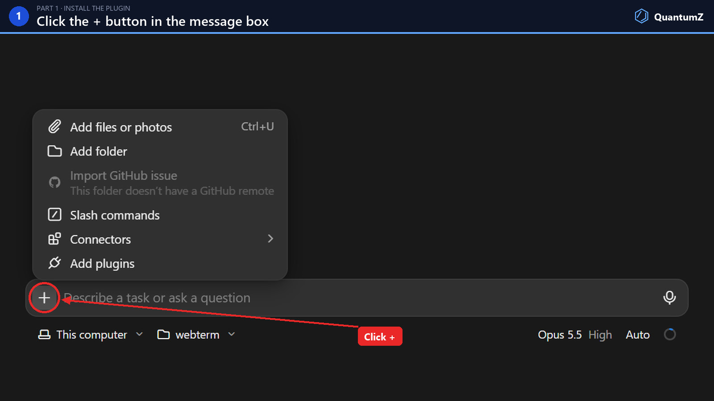

2. In the menu, choose Add plugins. The Directory opens on the Plugins tab.

   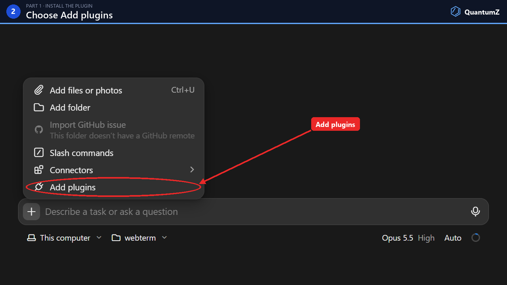

3. Click the + at the top right of the plugin list to add a marketplace.

   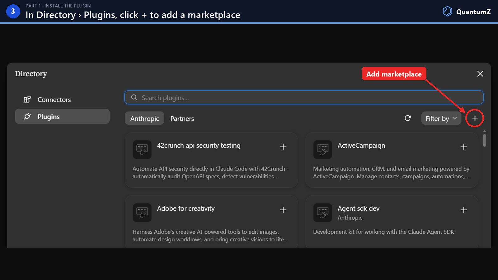

4. Choose Add from a repository.

   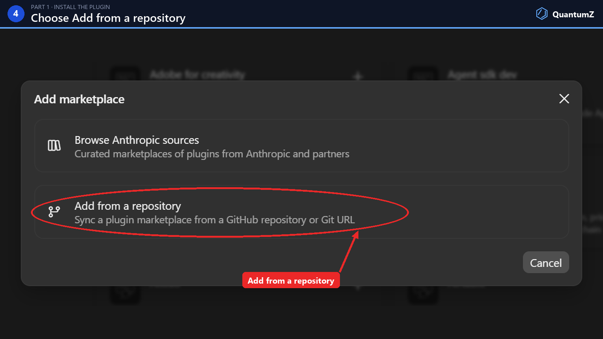

5. In URL, type `quantumz-io/qmz-claude`, pick it from the list, then click Sync.

   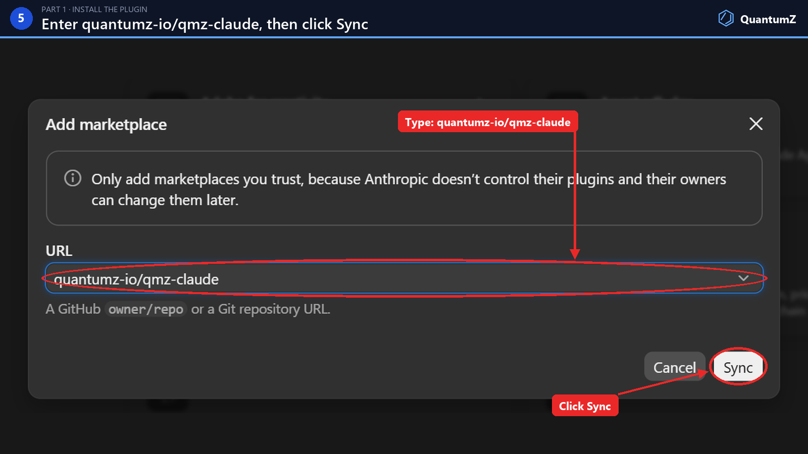

6. A Code tab appears with the quantumz marketplace. Click + on VeloxQ Solve.

   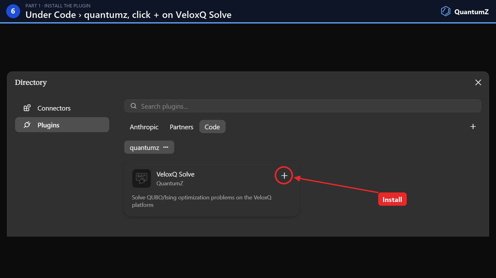

7. The + turns into a settings gear, and a toast confirms "VeloxQ Solve is installed and ready to use."

   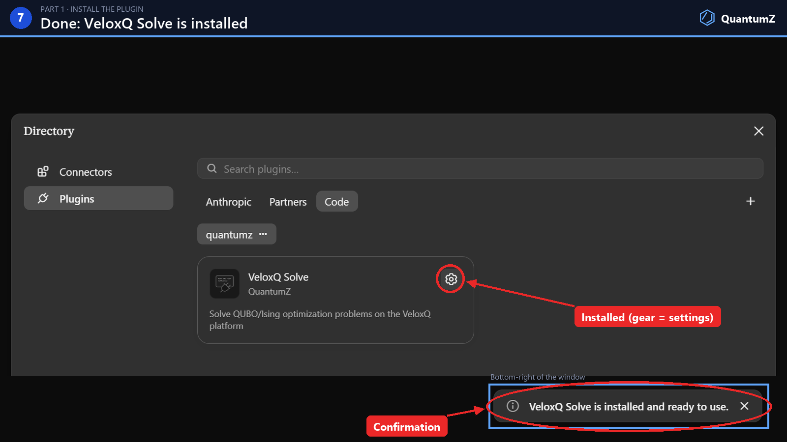

#### Part 2: connect the VeloxQ connector

8. Close the Directory. Click + in the message box, then Connectors › Manage connectors.

   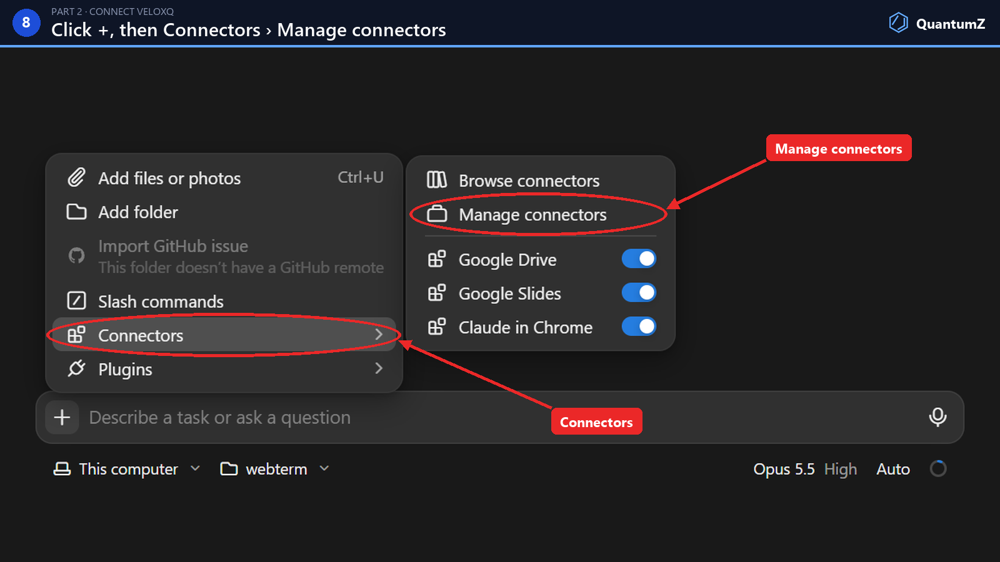

9. In Settings › Customize › Connectors, click veloxq ("Provided by the VeloxQ Solve plugin").

   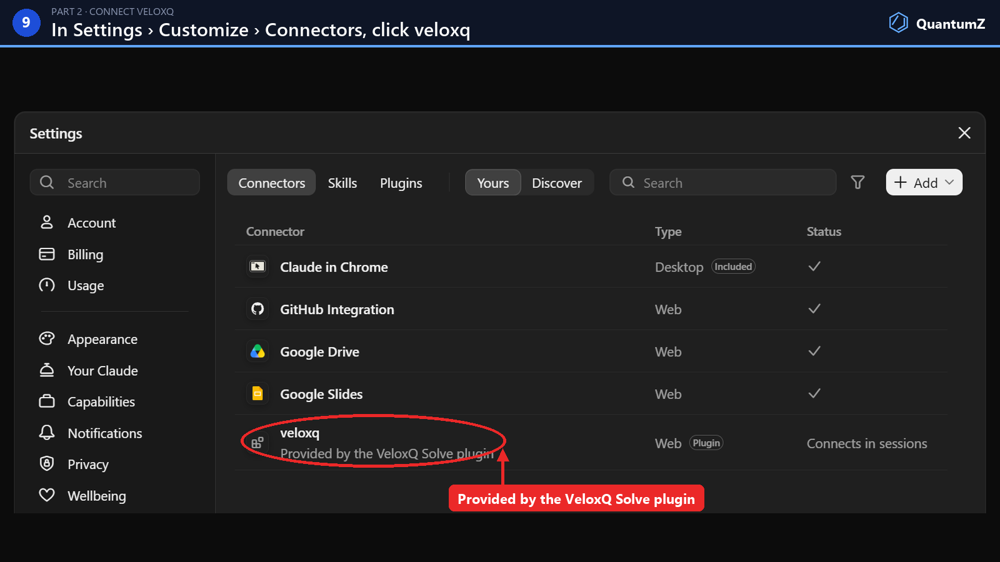

10. The VeloxQ Solve plugin page opens on Connectors. Click veloxq, shown as Not added.

    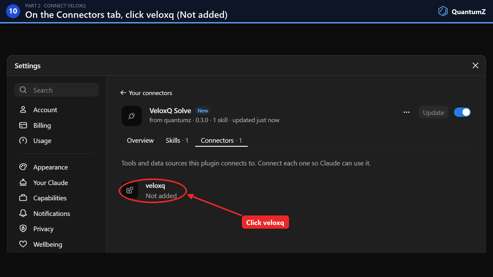

11. Claude reports "You're not connected to veloxq yet." Click Connect.

    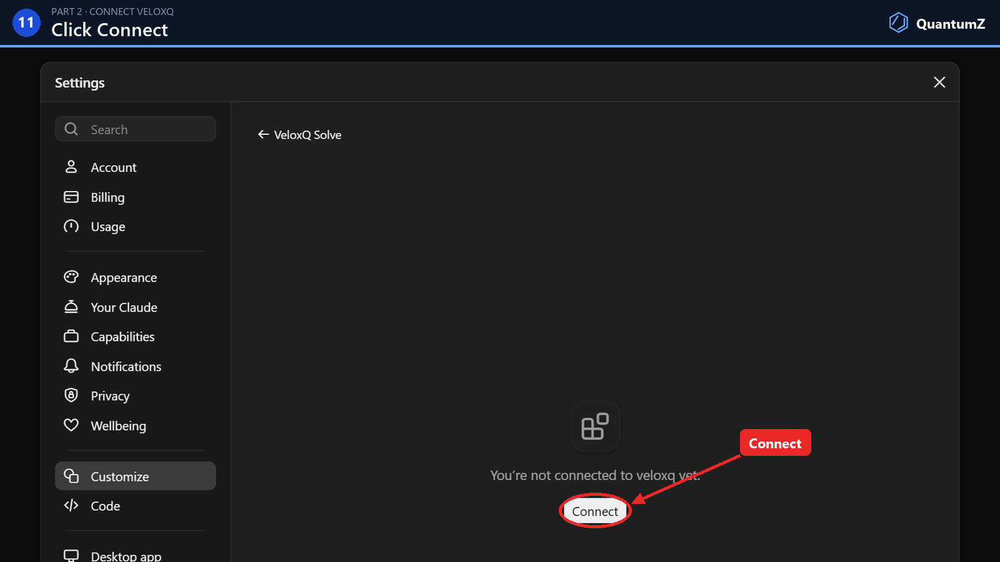

12. Claude asks to open api.veloxq.com to authorize veloxq. Click OK. Your browser opens.

    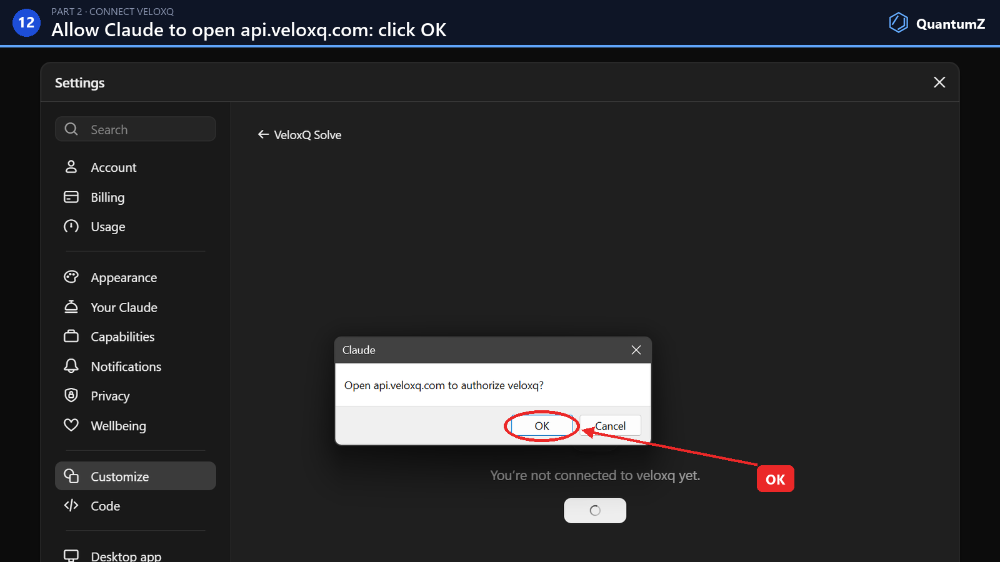

13. Sign in to the VeloxQ Platform with your VeloxQ account (e-mail and password, PLGrid or Google).

    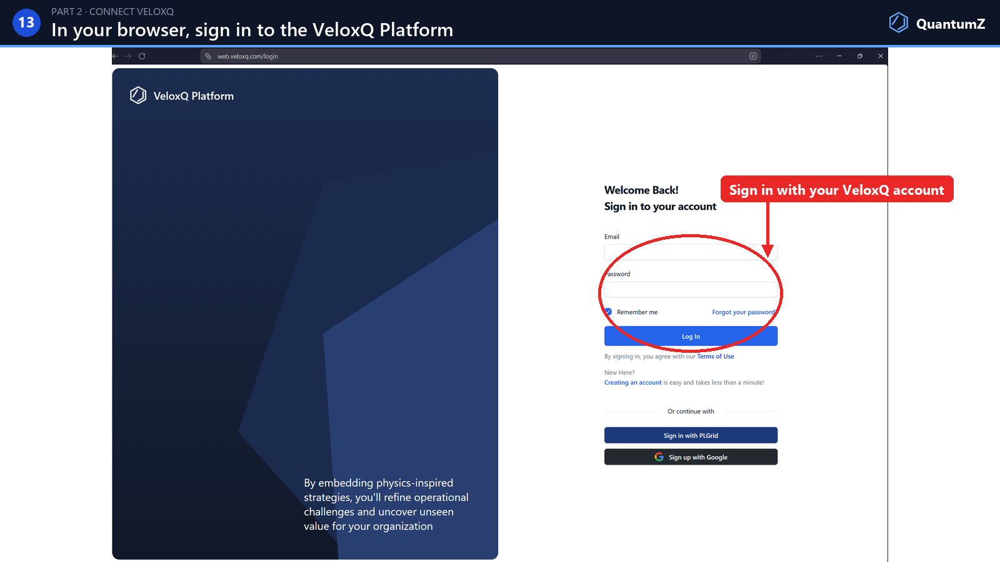

14. Check that you are signed in to the right account, review what Claude Code may access, and click Allow.

    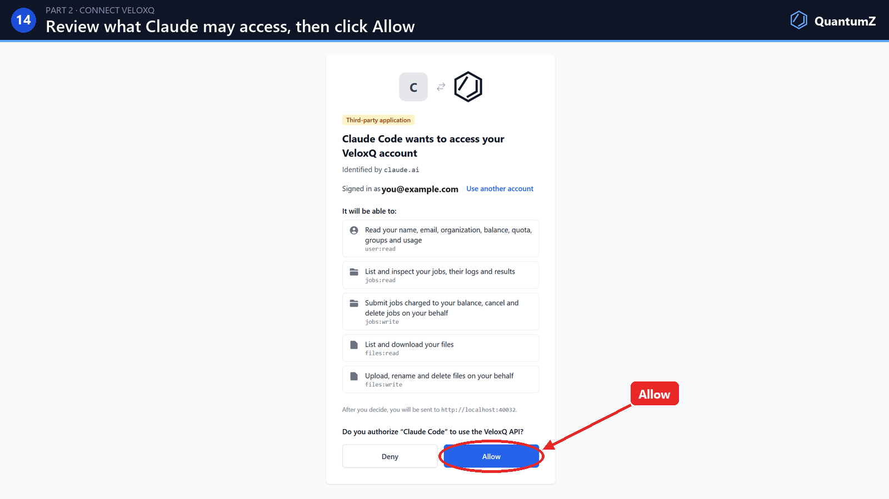

15. The browser shows Authentication successful. Close the tab and switch back to Claude.

    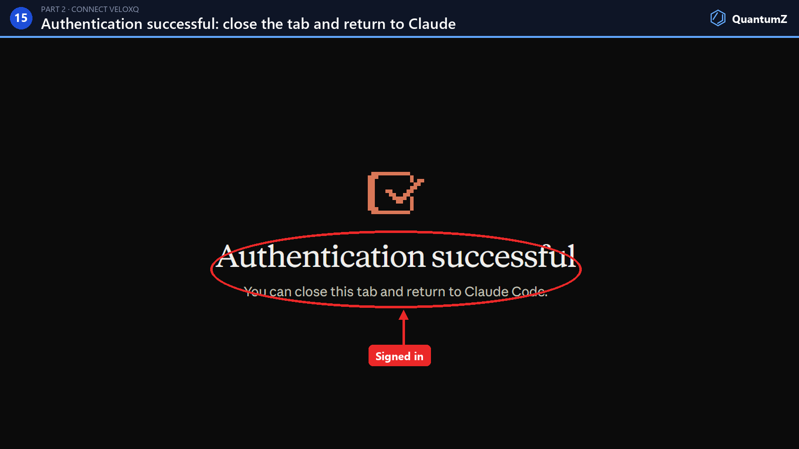

16. Claude says "Finish signing in to veloxq in your browser, then click Done." Click Done.

    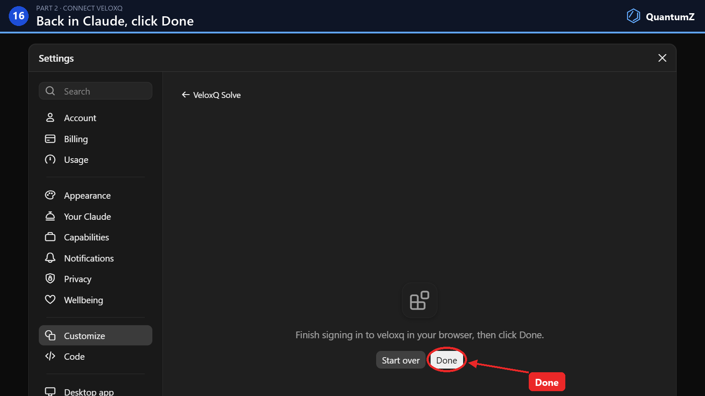

17. Done: "veloxq is connected. New sessions will pick this up automatically," and a toast confirms it.

    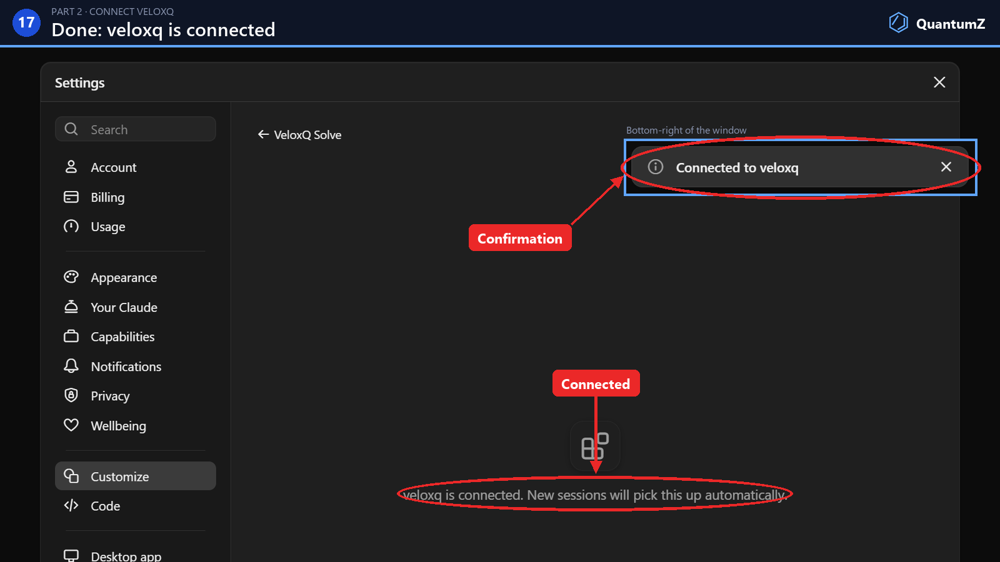

Start a new session so the plugin's skill and the `veloxq` server load.
To disconnect, use Settings › Customize › Connectors › veloxq, or revoke
Claude Code on the connected applications page of your VeloxQ account. The
gear on the plugin's card in Directory › Plugins removes the plugin, and
the … menu next to `quantumz` removes the marketplace.

### Claude Code terminal

Run each command on its own in a Claude Code session.

- Register the marketplace:

  ```bash
  /plugin marketplace add quantumz-io/qmz-claude
  ```

- Install the plugin from this marketplace:

  ```bash
  /plugin install veloxq-solve@quantumz
  ```

- Connect the `veloxq` server: run `/mcp`, select `veloxq` and authenticate.
  The VeloxQ consent page opens in the browser. Sign in, click Allow, and
  return to the terminal.

## What it does

The plugin provides two things: the connection to the `veloxq` MCP server,
whose tools let Claude use the VeloxQ platform, and the `veloxq-solve`
skill, which drives those tools through a complete solve. The agent reaches
the platform through the tools, and through the VeloxQ SDK only for models
too large to pass through a tool call.

### The MCP server

The server is hosted by QuantumZ at `https://mcp.veloxq.com/mcp`, the same
server that claude.ai reaches as a connector. `.mcp.json` declares it, and
Claude Code connects to it when the plugin loads. Its tools are named
`mcp__plugin_veloxq-solve_veloxq__<tool>`:

| Tool | Purpose |
| --- | --- |
| `account` | The account's balance, quota and groups |
| `session_token` | The connection's access token, for the VeloxQ SDK on this machine |
| `list_solvers` | Solvers with their parameter schemas, costs and backends |
| `submit_job` | Start a job on an inline QUBO or Ising model, or on a file uploaded with the SDK |
| `get_job` | Status, timeline, cost and parameters of a job, optionally waiting for it to end |
| `get_result` | The best samples of a finished job, with objectives recomputed locally |
| `report` | The visual report of a solve, downloaded as one HTML file |
| `list_jobs`, `job_logs`, `cancel_job` | Inspect and control jobs |

The server acts on the user's own account. On first use the server shows as
needing authentication under `/mcp`; authenticating opens the VeloxQ consent
page in the browser, the user logs in there and approves the access once,
and Claude Code keeps the resulting tokens and refreshes them by itself. No
password, token or key ever passes through the conversation. The user can
end the connection at any time from `/mcp` or from the connected
applications page of their VeloxQ account.

### The skill

The skill activates when a conversation involves a combinatorial or
discrete optimization problem, such as max-cut, graph partitioning, graph
coloring, number partitioning, knapsack, TSP/routing, scheduling, maximum
independent set, portfolio selection, spin glasses, or mentions QUBO,
Ising, annealing, or VeloxQ directly. Claude then:

1. Checks with `account` that the tools reach the user's account, and
   points the user to `/mcp` to authenticate when they do not.
2. Formulates the problem as a QUBO or Ising model, using a catalog of
   standard encodings (`skills/veloxq-solve/references/qubo-formulations.md`)
   with guidance on penalty-weight selection.
3. Submits the model with `submit_job`, follows it with `get_job` and
   fetches the samples with `get_result`. Models are given as JSON
   coefficient lists or matrices, up to 20,000 coefficients. A larger model
   is uploaded from this machine with the VeloxQ SDK and the connection's
   own access token, then submitted by file id. The energies of returned
   samples are recomputed locally instead of being trusted from the platform.
4. Decodes the best samples back into the problem's own terms and checks
   every hard constraint before reporting.
5. Presents the result in the conversation and offers a visual report. On
   yes the `report` tool renders one HTML page with figures of the decoded
   solution (the partitioned graph, the packed knapsack, the tour, the
   schedule), the constraint checks, the distribution of sample objectives,
   and the model's coupling graph in its best state. The page loads nothing
   from the network and follows the viewer's light or dark theme. In Claude
   Code Claude downloads the page from the server as a self-contained file
   and hands it over as a link: a private Claude artifact if the user chose
   that and the Artifact tool is available, otherwise a link to the local
   file.

For control over submissions, the tools also list recent jobs, check a
single job's status and timeline, and read its platform logs, all without
resubmitting. If a session ends before a job's result comes back,
`get_result` on the job id fetches its verified result instead of
submitting again.

## Example prompts

The following prompts all activate the skill. They are adapted from the
plugin's eval suite, which verifies each returned solution against
the known optimum.

Number partitioning:

> I have these server loads [23, 45, 12, 67, 34, 89, 21, 43, 55, 18] and want to split them across two racks so the total load is as balanced as possible.

Max-cut:

> Solve max-cut on this 8-node graph: edges = [(0,1),(0,3),(1,2),(1,4),(2,5),(3,4),(3,6),(4,5),(4,7),(5,7),(6,7),(2,7)]. Which nodes go on each side, and how many edges are cut?

A QUBO given directly as a matrix:

> I need to minimize x^T Q x over binary x, with symmetric Q = [[-3,2,0,1,0,0],[2,-5,2,0,1,0],[0,2,-2,3,0,0],[1,0,3,-6,2,1],[0,1,0,2,-4,2],[0,0,0,1,2,-3]]. Give me the optimal assignment and objective value.

Max-3-SAT, which needs quadratization before submission:

>I have this 3-SAT instance over variables x1..x6 and want an assignment satisfying as many clauses as possible: (x1 v x2 v x3), (!x2 v x4 v !x5), (!x1 v !x6 v x5), (x3 v x5 v x6), (!x3 v !x4 v !x5), (x2 v x4 v x6), (!x1 v x4 v !x2), (x1 v !x5 v x6), (!x6 v !x2 v x3).

Graph coloring:

> Here's a 6-node graph: triangle edges (0,1),(1,2),(0,2) and (3,4),(4,5),(3,5), plus rungs (0,3),(1,4),(2,5). Find me a valid 3-coloring.

Knapsack, whose capacity constraint is encoded with slack variables:

> I have 8 items, weights [12, 7, 11, 8, 9, 6, 5, 14], values [24, 13, 23, 15, 16, 8, 7, 25], capacity 30. Which items should I take to maximize the total value?

A large instance:

> Generate a ferromagnetic Ising ring with 50,000 spins (J_{i,i+1} = -1 around the ring, periodic boundary conditions, no external fields) and solve it. What ground-state energy does the solver reach, and is it the true ground state?

## Requirements

- Network access to `mcp.veloxq.com` and a browser for the one-time consent
- A VeloxQ account
- Python with the [veloxq-sdk](https://pypi.org/project/veloxq-sdk/)
  package, only for models above 20,000 coefficients

Claude Code identifies itself to the VeloxQ API with the OAuth client ID
metadata document Anthropic hosts for it,
`https://claude.ai/oauth/claude-code-client-metadata`, so no client is
registered by hand and there is no secret. The VeloxQ API accepts exactly
two metadata documents, Claude's and Claude Code's.

## Using it on claude.ai

claude.ai reaches the same server as a custom connector. The skill is
uploaded separately and needs the connector. On claude.ai models are inline
only and the report is shown in the conversation as an MCP App.

### Adding the connector and the skill

1. In claude.ai, Settings → Connectors → Add custom connector, with the name
   `VeloxQ Connector`, the URL `https://mcp.veloxq.com/mcp`, and Advanced
   settings left empty.
   Connecting opens the VeloxQ consent page.
2. Build the skill archive and upload it under Settings → Capabilities →
   Skills. With code execution enabled Claude decodes and checks the samples
   in a script; the report itself is built by the server.

   ```
   cd skills && zip -r veloxq-solve.zip veloxq-solve -x '*/__pycache__/*'
   ```

## Contents

| Path | Purpose |
| --- | --- |
| `.mcp.json` | Declares the `veloxq` MCP server at `https://mcp.veloxq.com/mcp` |
| `skills/veloxq-solve/SKILL.md` | The skill: workflow, submission formats, verification, troubleshooting |
| `skills/veloxq-solve/references/qubo-formulations.md` | Encoding catalog for standard problems and penalty-weight guidance |
| `skills/veloxq-solve/references/report-views.md` | Format of the report's view spec and which figure suits which problem |
